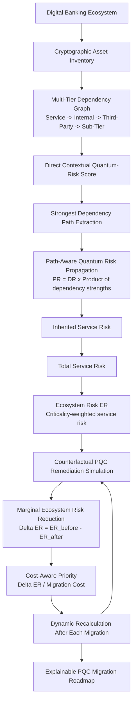

# Final PQC Banking Risk Framework Architecture

The feedback loop from dynamic recalculation to remediation simulation is central: after each selected action, all remaining candidates are re-evaluated against the updated ecosystem state.
