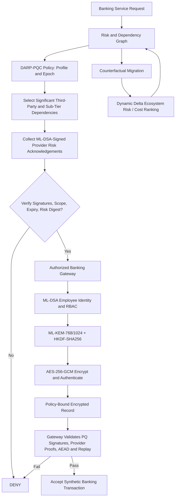

# COMPLETED RESEARCH PROTOTYPE — GUIDE / DEMONSTRATION GUIDE

**Project name:** Dependency-Aware Risk-Bound Post-Quantum Protection and Multi-Tier Remediation Prioritization for Digital Banking

**Status:** Research prototype implemented and run on synthetic banking data. **Not** a production-ready banking cryptographic system or an independently validated patent.

## 1. What was kept

The original multi-tier banking dataset, NetworkX dependency model, direct and inherited quantum-risk calculation, ecosystem risk, and dynamic remediation prioritization are intact. V1 has 50 assets (25 internal, 15 third-party, 10 sub-tier), 10 services, 77 dependency rows and 71 unique graph edges. V2 contains 250 assets / 20 services / 720 edges and remains available for scalability experiments.

## 2. Final architecture



**NIST standardized primitives, not home-made encryption:** ML-KEM (FIPS 203), ML-DSA (FIPS 204), SLH-DSA (FIPS 205 alternative benchmark), AES-256-GCM for actual authenticated data encryption, HKDF-SHA256 for key derivation.

## 3. Proposed SYSTEM-level algorithm (DARP-PQC + Cross-Tier Assurance)

For banking service `s`, the framework computes a risk-profile policy `P_s` (risk score, mandatory ML-KEM/ML-DSA profile, risk evidence digest and monotonic policy epoch). For each external tier `t` (direct provider, sub-tier), it selects the highest propagated-risk reachable asset above configurable threshold `tau`:

```
Q(s,t) = TopK { a : tier(a)=t, Reachable(s,a), PathRisk(s,a)>=tau }
```

Each selected provider must sign the *specific banking record and policy state*:

```
attestation = ML-DSA.Sign(provider_key,
   domain || asset_id || provider || tier || service_id || action
   || policy_digest || policy_epoch || risk_evidence_digest
   || SHA256(canonical_record) || issued_at || expires_at || nonce
   || "reviewed_and_acknowledged_quantum_risk")
```

The server rejects if any required provider acknowledgement is absent, expired, altered, signed by an unregistered key, or bound to the wrong banking record, service or risk-policy epoch. The server also checks the bank employee's ML-DSA signature, access-control role, freshness/replay protection, authenticated decryption, and authorized PQC profile. This is a **risk-acknowledgement and accountability gate**, **NOT cryptographic proof that the provider has deployed PQC**.

**Important:** The research version selects `K=1` per external tier and `tau=0.35`. These are transparent experimental choices, not regulatory requirements. Sensitivity studies should assess different settings before claims of operational optimality.

## 4. Actual operations implemented

| Requirement | Implemented and tested |
|---|---|
| Quantum-resistant key establishment | ML-KEM-768 (Category 3) and ML-KEM-1024 (Category 5) |
| Banking record encryption | AES-256-GCM, key derived from ML-KEM secret with HKDF-SHA256 |
| Record decryption and tamper detection | Authenticated AES-GCM decrypt; reject invalid authentication tag |
| Banking identity and signature | ML-DSA-65 / ML-DSA-87, signature bound to policy and record |
| Post-quantum role access control | Employee ML-DSA-signed request; RBAC; expiry; anti-replay |
| Multi-tier provider controls | Independent simulated third-party and sub-tier signatures required by the server |
| Hash-based PQ alternative | SLH-DSA-SHA2-128s benchmark and verification test |
| Migration link | Graph risk changes update policy epochs and required PQ security profile |
| Explainability and research comparisons | Risk-path data, migration baselines and two-tier gate ablation CSV |

## 5. Results generated by this package

### V1 ecosystem risk-reduction experiment (unchanged)

Equal nominal migration budget = 7.5 cost units, synthetic V1 dataset:

| Approach | Final ecosystem risk | Risk reduction |
|---|---:|---:|
| Proposed dynamic marginal risk reduction per cost | 0.439112 | 43.61% |
| Business-criticality baseline | 0.584322 | 24.96% |
| Direct-risk baseline | 0.593505 | 23.79% |
| HNDL-risk baseline | 0.603723 | 22.47% |

Initial ecosystem-risk score: **0.778727**. Scores are normalized **model indices, not breach probabilities**.

### Cross-tier encryption / attestation ablation — current environment

20 successful repeated V1 S01 Core Banking transactions. Same elevated bank security profile in both cases: **ML-KEM-1024 + ML-DSA-87 + AES-256-GCM**.

| Scenario | Median wall time | p95 | Median JSON envelope | Required provider signatures |
|---|---:|---:|---:|---:|
| DARP-PQC without cross-tier gate | 37.083 ms | 58.553 ms | 20,704 B | 0 |
| DARP-PQC + strict cross-tier gate | 62.510 ms | 83.272 ms | 34,204 B | 2 |

Required provider evidence selected by graph: **A026 Cloud KMS** (third party, propagated path risk 0.8742) and **A041 Cloud Sub-KMS** (sub-tier, propagated path risk 0.76986).

The strict gate adds ~25.427 ms median and ~13,500 bytes in this local setup. Higher overhead is a real cost; the technical gain is **enforcement of verified, risk-scoped external-party acknowledgements**, not improved speed or proof of provider quantum safety. Timings include OpenSSL subprocess launch, Python serialization, file I/O, key operations, signatures, and double gate checking. Different host hardware and backends will produce different numbers.

### Additional hash-based PQ algorithm

The `SLH-DSA-SHA2-128s` benchmark signed and verified successfully, with a **7,856-byte signature**. Its local CLI timing was approximately **292.6 ms median signing** over 12 runs, compared with **7.7 ms** for ML-DSA-65 in the same benchmark. Since the algorithms have different security levels and implementation characteristics, this is an illustrative experimental overhead comparison, not a claim of equivalent protection or optimized library performance.

**Automated tests:** **37 passed** on the current evaluation host (OpenSSL 3.5.5). Tests cover encryption, decryption, authenticated signatures, role authorization, tampering, algorithm downgrade, stale policies, replay, cross-service binding, missing provider, duplicate provider, expired valid provider proof, record mismatch, and SLH-DSA signature verification.

## 6. Install and run on the user's Mac

Open the extracted directory in VS Code and run these in the **project root**, not `src`:

```bash
python3 -m venv .venv
source .venv/bin/activate
python -m pip install -r requirements.txt
brew install openssl@3
export OPENSSL_BIN="$(brew --prefix openssl@3)/bin/openssl"
"$OPENSSL_BIN" version  # must be >= 3.5
```

Run the main demonstration:

```bash
python -m unittest discover -s tests -v
python -m experiments.final_evaluation
python -m experiments.banking_gateway_demo
python -m experiments.cross_tier_final_evaluation --iterations 20
python -m experiments.darp_policy_migration_demo
python -m experiments.cross_tier_scalability
python -m experiments.pqc_benchmark --iterations 12
```

You can also run `bash run_complete.sh` to execute these steps. The bash script does not install packages. On different machines, **regenerate and report locally measured timings**; do not reuse the numbers above as if they came from the user's Mac.

## 7. Essential final outputs

- `results/tables/final_strategy_comparison_v1.csv` — proposed migration strategy vs three baselines.
- `results/tables/final_path_contributions_v1.csv` — explainable risk propagation.
- `results/tables/banking_gateway_demo.json` — encryption/decryption and signed third-party/sub-tier assurance result.
- `results/tables/cross_tier_ablation.csv` — extension overhead vs DARP baseline.
- `results/tables/cross_tier_proof_demo.json` — selected third-party/sub-tier paths and adversarial checks.
- `results/tables/cross_tier_scalability.csv` — graph-derived requirement selection across V1 and V2.
- `results/tables/pqc_benchmark.csv` — ML-KEM, ML-DSA, SLH-DSA and classical comparator operations.
- `results/tables/darp_policy_migration_demo.json` — migration risk state change and stale-policy rejection.
- `tests/test_cross_tier.py` — targeted cross-tier security tests.

## 8. Guide viva / presentation explanation

“Our system evaluates quantum-vulnerable internal, third-party and sub-tier dependencies, then prioritizes migrations by their marginal ecosystem-wide risk reduction. We implemented real NIST PQC key establishment and signatures for encrypted banking records. The extension selects risk-significant provider chains and requires independently signed, record- and policy-bound third-party and sub-tier acknowledgements; a strict banking gateway enforces these alongside authenticated encryption and role checks. We compare the existing migration risk results and the security-enforcement ablation, reporting the extra processing overhead honestly.”

## 9. What this demo DOES NOT establish

- It is **not** an audit of real cloud vendors or evidence that their RSA/ECC has been migrated.
- External provider signers are simulated with independently generated local keys. A production banking system requires authentic external PKI, trust onboarding, hardware key custody, certificate revocation, durable nonce stores, and distributed policy consistency.
- ML-KEM encapsulation to **static recipient public keys does not provide forward secrecy** against later compromise of that long-term recipient private key; this is particularly important under HNDL threat models. A deployed banking protocol requires separately designed ephemeral/hybrid forward-secret session negotiation and analysis.
- A risk acknowledgement by a vulnerable provider is not equivalent to protecting data processed by that provider. Additional secure channel, data-at-rest, vendor verification and migration controls are required.
- No live banking customers, payment processors, financial APIs or production accounts are used.
- No formal cryptographic proof, external security audit, independent bank-specific calibration, or legal patentability opinion has been performed.

## 10. What to present as the research contribution

The novel *hypothesis* is the **integrated technical enforcement loop**: path-propagated risk in multi-tier banking infrastructure selects required external-party signers; those sign short-lived attestations cryptographically bound to risk-evidence digests, service, epoch, action and the protected record; the banking gateway fails closed on missing/stale proofs; migration recalculates both ecosystem risk and enforced policy. The standardized underlying cryptographic primitives are NOT novel. Patent novelty must be assessed against prior art.
